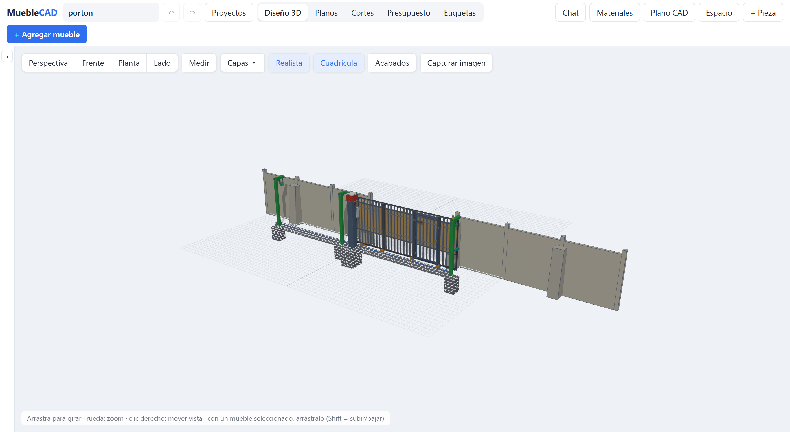

# MuebleCAD

Diseño 3D de muebles en madera con lista de cortes, optimización de planchas, tapacanto, presupuesto y agente de IA (MCP).

Repositorio: https://github.com/pjvb10-tech/mueblecad-app · Licencia MIT · Este proyecto no acepta contribuciones externas (ver [CONTRIBUTING.md](CONTRIBUTING.md)); las bifurcaciones están permitidas por la licencia.

## Uso

- **App de escritorio:** `npm.cmd run dist` genera en `release/` el instalador `MuebleCAD-Setup.exe` y la versión portátil `MuebleCAD.exe`. Guardan los datos en `Documentos\MuebleCAD\`. Ambos traen el servidor MCP incluido (no hace falta Node ni el código).
- **Modo desarrollo:** `iniciar.bat` o `npm.cmd run dev` y abrir http://localhost:5173 (datos en `data/`).
- `npm.cmd test` corre las pruebas del núcleo.
- `npm run typecheck` revisa los tipos (`tsc --noEmit`).

Medidas en mm. X ancho, Y alto, Z fondo; el frente de los muebles mira a +Z.

## Instalación desde cero

Requisitos: [Node.js](https://nodejs.org) 20 o superior (incluye npm) y Git.

```bash
git clone <URL de tu fork o del repositorio> mueblecad
cd mueblecad
npm install
npm run dev        # abre http://localhost:5173
npm test           # pruebas (opcional)
```

En Windows con PowerShell usa `npm.cmd` si `npm` está bloqueado por la política de scripts.

**Dónde se guardan tus datos:** por omisión en la carpeta `data/` del repositorio (ignorada por git). Para usar otra carpeta, define la variable de entorno `MUEBLECAD_DATA` antes de arrancar, por ejemplo:

```bash
# Mac / Linux
MUEBLECAD_DATA="$HOME/Documents/MuebleCAD" npm run dev
```
```powershell
# Windows (PowerShell)
$env:MUEBLECAD_DATA = "$HOME\Documents\MuebleCAD"; npm.cmd run dev
```

La misma variable se usa al registrar el servidor MCP (ver más abajo).

## Proyecto de ejemplo: portón corredizo



`docs/ejemplos/porton.json` es un portón corredizo de 4,8 m con puerta peatonal, muro, bases de hormigón, motor y cables. Está armado con piezas de formas sólidas (`tube`, `prism`, `revolve`) y con rotaciones; ver [docs/formas.md](docs/formas.md). También hay una demostración de formas en `docs/ejemplos/formas.json`.

**Cargarlo:**
1. Arranca la app una vez con tu carpeta de datos (`npm run dev`) para que exista.
2. Haz una copia de seguridad de tu `project.json` si ya tienes diseños.
3. Copia el ejemplo como `project.json` dentro de la carpeta de datos (`data/` o la de `MUEBLECAD_DATA`):
   ```bash
   cp docs/ejemplos/porton.json data/project.json
   ```
   O bien, desde la app: **Abrir…** (o Proyectos > Importar proyecto) y elige `porton.json` (los `.json` antiguos se siguen abriendo).
4. Abre o recarga http://localhost:5173.

## Mac con chip Apple (M1, M2, M3, M4)

Un programa de Mac solo se puede compilar en un Mac o en los servidores de GitHub; no desde Windows.

**Opción A, en un Mac** (necesita [Node.js](https://nodejs.org) 20 o superior):
```
npm install
npm run dist:mac        # crea release/MuebleCAD-<versión>-mac-arm64.dmg (y .zip)
```
Para solo probarlo sin instalar nada: `chmod +x iniciar.command` y doble clic en `iniciar.command`.

**Opción B, sin Mac:** sube el proyecto a GitHub, abre la pestaña *Actions* y ejecuta *Compilar apps* (`.github/workflows/build.yml`). Deja el `.dmg` de Mac y el `.exe` de Windows para descargar.

**Primera vez que se abre:** la app lleva firma ad-hoc, sin cuenta de desarrollador de Apple, así que macOS avisa que no puede verificarla. Haz clic derecho sobre MuebleCAD > *Abrir* > *Abrir*, o ejecuta una vez `xattr -cr /Applications/MuebleCAD.app`.
Los datos se guardan en `~/Documents/MuebleCAD/`. Los atajos usan **Cmd** en vez de Ctrl (Cmd+Z, Cmd+Shift+Z, Cmd+D) y Borrar elimina lo seleccionado.
Para conectar el agente en Mac: `claude mcp add mueblecad -e MUEBLECAD_DATA=$HOME/Documents/MuebleCAD -- npx tsx /ruta/al/proyecto/server/mcp.ts`.
Para Mac con Intel, cambia `--arm64` por `--x64` en el script `dist:mac`.

## Funciones

| Área | Qué hace |
|---|---|
| Edición | Arrastrar muebles en el 3D con imanes a otras piezas y a los muros (Shift = subir/bajar), deshacer/rehacer (Ctrl+Z / Ctrl+Y), duplicar (Ctrl+D), Supr para borrar |
| Medidas | Cotas de ancho/alto/fondo sobre el mueble seleccionado, herramienta **Medir** entre dos puntos, **Planos** 2D acotados (frente, planta, lado) |
| Muebles | Plantillas (base, alto, cajonera, **esquinero en L**, closet, librero), cajones con correderas, **número de puertas a elegir**, fondo (entre laterales o **embutido en rebaje**), **plantillas propias**. Los muebles generados se pueden **regenerar con otras medidas** desde el panel |
| Piezas | Tapacanto por canto, esquinas redondeadas, cortes en L (muesca), huecos, **rebajes** (ranuras de 3×8 mm para el fondo) |
| Cortes | Distribución en planchas con **cortes de guillotina numerados**, kerf y veta; exporta **CSV**, **DXF** y **G-code para CNC** (fresa, avances y pasadas configurables); **etiquetas** por pieza; **PDF directo** desde la app |
| Presupuesto | Planchas, tapacanto (m) y herrajes (bisagras, manijas, soportes, correderas calculados del diseño) con precios editables |
| Plano CAD | Importa un **DXF o DWG de AutoCAD** (el DWG se convierte con LibreDWG, que no viene incluido: copia `dwg2dxf.exe` en `herramientas`): elige unidades y capas, calibra con una medida real, gira para elegir el muro del fondo y **marca el espacio con el mouse**; el programa se ajusta a las caras interiores de los muros y mide su espesor. Muestra textos y cotas, con zoom y desplazamiento. Lee los **paneles de muro** perimetrales (MP) e interiores (MI) como cajas con su espesor y arma **elevaciones de muro** en el 3D, que también se ven en la ventana **Elevaciones**. Si el dibujo trae elevaciones de paneles (rectángulos con una X y etiquetas B##), lee **puertas y ventanas**, las abre en los muros del espacio, toma la altura de los paneles y guarda el plano de techo como capa. La capa **Techo (ensamble)** del 3D dibuja un **panel sólido de 210 mm de espesor por cada recuadro** del plano de techo (cara inferior a la altura del cielo, semitransparente, sin sombra), con su etiqueta H##/T##; las celdas se calculan al cargar (`src/core/roof.ts`) y no entran en cortes ni presupuesto. Los **identificadores** (H# habitaciones con nombre editable, P# muros perimetrales, I# interiores, D# puertas y V# ventanas) se listan en la ventana **Identificadores**. Puedes **agregar puertas o ventanas a mano** sobre un muro por su clave (el plano no trae las del perímetro). Avisa cuando un mueble bloquea una puerta o tapa una ventana. Con `?debug` en la dirección se expone `window.__viewer` (solo con ese parámetro) |
| Espacio | Piso, muros y ventana (se pueden **importar de un .json**); los muebles se pegan a los muros; botones para **pegar al fondo, a un lado, centrar o llenar el ancho** |
| Materiales | Editor de materiales: espesor, medidas de plancha, color, veta, precio, «comprado» y **foto de textura** |
| Vista | Capas automáticas y **capas propias**, texturas (veta o foto) y sombras, vistas rápidas, captura PNG en alta resolución |
| Proyectos | Varios proyectos en una biblioteca (autoguardada en `Documentos/MuebleCAD`); abrir, copiar, nuevo; **Abrir… / Guardar / Guardar como…** con archivos **.mcad** (ver «Archivos .mcad») |

## Archivos .mcad

El formato nativo es **`.mcad`**: un JSON de texto UTF-8 (sin comprimir: legible, comparable con diff y sin depender de APIs de compresión) con un envoltorio versionado `{ "formato": "mcad", "version": 1, "project": { ... } }`. El núcleo (`src/core/mcad.ts`) serializa, lee y migra por versión (`MIGRATIONS[n]` convierte de la versión n a la n+1; un archivo de una versión más nueva se rechaza con un mensaje claro). Los `.json` antiguos (el proyecto plano) se siguen importando.

- **Abrir…**, **Guardar** (Ctrl+S) y **Guardar como…** (Ctrl+Mayús+S) en la barra superior; en Proyectos, «Exportar proyecto (.mcad)» e «Importar proyecto…» (acepta .mcad y .json).
- **App de escritorio**: diálogos nativos; si el proyecto vino de un archivo, **Guardar** reescribe esa ruta (solo rutas elegidas por ti en un diálogo o abiertas con doble clic). El instalador (`MuebleCAD-Setup.exe`) asocia la extensión `.mcad`: doble clic lo abre en la instancia ya abierta (instancia única; también `open-file` en Mac). Con la versión portátil no hay asociación, pero `MuebleCAD.exe archivo.mcad` también lo abre.
- **Web/servidor**: Abrir con el selector de archivos; Guardar y Guardar como descargan el `.mcad`.
- El autoguardado en la biblioteca `Documentos/MuebleCAD` no cambia: abrir un `.mcad` lo copia a la biblioteca como proyecto activo.
- Por MCP: `export_mcad` e `import_mcad`.

## Dibujo 2D

Junto al 3D hay un **lienzo de dibujo 2D libre** (botones **3D / 2D** de la barra superior): dibujos con capas que viven en el mismo espacio del proyecto, se ven como líneas en el 3D y se pueden **extruir a sólidos** (polilíneas cerradas, rectángulos y círculos pasan a piezas `prism` / `cylinder`).


- **Dibujar con el ratón**: Línea, Polilínea (con arcos), Rectángulo, Círculo (centro-radio/diámetro, 2 y 3 puntos), Arco, Texto y Cota. **Editar**: Mover, Copiar, Rotar, Escalar, Simetría, Desfase, Recortar (TR), Extender (EX) y Borrar, con selección por clic, ventana (izquierda a derecha) o cruce (derecha a izquierda). Todo es un solo paso de deshacer.
- **Recortar y extender**: TR y EX recortan o alargan líneas, arcos, círculos y polilíneas contra los bordes que designes (o todos); Mayús invierte la acción. Los bloques insertados no se recortan ni sirven de borde (explótalos), y los sombreados asociativos siguen al contorno modificado. MCP: `trim_entity`, `extend_entity`.
- **Sombreados** (herramienta «Sombreado», H): clic dentro de una región cerrada (detecta islas) o elige el contorno; patrones sólido, líneas, cuadrícula, puntos, ANSI31, ladrillo, concreto y madera, con ángulo, separación y color; exporta como HATCH nativo de DXF cuando el patrón existe en AutoCAD. MCP: `draw_hatch`.
- **Bloques editables** («Crear bloque», «Insertar», «Explotar» y la pestaña «Bloques»): editar un bloque actualiza todas sus instancias; se exportan e importan como BLOCK/INSERT de DXF. MCP: `block_create`, `block_list`, `block_get`, `block_update`, `block_remove`, `insert_block`, `explode_insert`. Detalles en [docs/dibujo-2d.md](docs/dibujo-2d.md).
- **Imán** (botones bajo el lienzo): extremo, medio, centro, cuadrante, intersección, perpendicular, tangente, cercano, rejilla, **Orto (F8)** y polar.
- **Línea de comandos** (abajo): escribe el comando y Enter (`L`, `PL`, `REC`, `C`, `A`, `T`, `DIM`, `M`, `CO`, `RO`, `SC`, `MI`, `O`, `E`, `TR`, `EX`, `H`, `B`, `I`, `X`) o coordenadas: `x,y`, `@dx,dy`, `@distancia<ángulo`, o solo una distancia en la dirección del cursor. Una letra suelta es una opción de la herramienta (`C` cerrar, `A` arco, `U` deshacer último punto…); Enter vacío confirma o repite el último comando; Esc termina.
- **Capas, tabla de entidades** editable y **resaltado en vivo** de lo que dibuja un agente por MCP (herramientas `drawing_*`).
- **Importar DXF** (diálogo con unidades, «sin cotas», «sin capas congeladas»; muestra avisos y estadísticas) y **Exportar DXF R2000** (dibujo activo, todos en uno o un archivo por dibujo). Las cotas se exportan como líneas y texto.
- **Exportar PDF** vectorial (A4 a A0, horizontal o vertical, escala `fit` o 1:50…, cajetín con título, autor y fecha), con sombreados y bloques. Para PNG, JPG, SVG o láminas con varias vistas usa [Exportar vista](#exportar-vistas).
- **Importar 3D** (botón de la barra superior): OBJ, STL y glTF/GLB como piezas de forma `mesh` (pide unidad, eje arriba, escala y si separar objetos).
- Por MCP: `import_dxf` (lee de `importar/` en la carpeta de datos), `export_dxf`, `export_pdf` (escriben en `export/`), `import_mesh` y todas las `drawing_*`; ver [docs/mcp.md](docs/mcp.md) y [docs/dibujo-2d.md](docs/dibujo-2d.md).

**Límites**: no se lee **DWG** (guárdalo como DXF desde AutoCAD, LibreCAD o DWG TrueView) ni **SketchUp `.skp`** directamente (en SketchUp: Archivo > Exportar > Modelo 3D > OBJ, STL o glTF; COLLADA `.dae` no está soportado). No hay importar PDF; los splines y elipses del DXF se aproximan con polilíneas; las mallas importadas no entran en el despiece ni el presupuesto.

## Exportar vistas

El botón **Exportar vista** (barra superior) guarda lo que estás viendo como imagen o PDF:

- **Vista 3D del visor** → PNG, JPG o PDF. Se dibuja de nuevo con un renderizador aparte al tamaño pedido (1x, 2x, 4x o a medida, hasta 8192 px por lado), sin tocar el visor. Fondo blanco, gris del visor, color o transparente (PNG), con o sin cuadrícula y con o sin cotas/etiquetas. Vistas rápidas: actual, isométrica, frente, atrás, izquierda, derecha, superior y perspectiva (ortográfica o en perspectiva). El PDF lleva la imagen incrustada (JPEG) con cajetín (título, autor, fecha).
- **Dibujo 2D activo** → PNG, JPG, SVG o PDF vectorial (papel, escala y cajetín, como el export de PDF existente), con sus sombreados y bloques insertados. Si estás editando un bloque se exporta el dibujo completo, no el bloque. Área: todo el dibujo, la ventana actual o solo la selección.
- **Planos y lámina** → una hoja A4 a A0 con de 1 a 4 vistas (3D, frente, planta, lado, dibujo 2D) en cuadrícula, cada una con su escala, y cajetín. PDF (vectorial para los planos; la vista 3D va como imagen), PNG, JPG o SVG. Opción de adjuntar la lista de piezas en páginas aparte.
- Cada resultado se puede **descargar** o **guardar en export/** (carpeta de datos).
- **Vistas guardadas**: guarda con nombre la cámara 3D (posición, objetivo, capas apagadas) o el encuadre de un dibujo 2D en `project.views`; restáuralas con un clic o expórtalas directo.

El agente (MCP) puede pedirlo con `save_view` y `request_view_export` (ver docs/mcp.md).

## Usar MuebleCAD desde un agente (MCP)

MuebleCAD trae un servidor MCP para que un agente de IA (Claude Code u otro cliente MCP) cree muebles, saque cortes y presupuesto, pruebe acabados de piso y muros y estime cuántas losas comprar. Detalle completo, herramientas y ejemplos en **[docs/mcp.md](docs/mcp.md)**.

**Con la app instalada (sin Node ni repositorio):** abre MuebleCAD, pulsa **Conectar Claude** y copia el comando `claude mcp add ...` que muestra, ya con las rutas reales de tu instalación y de tu carpeta de datos (`Documentos/MuebleCAD`). El propio programa hace de Node (`MuebleCAD.exe` con `ELECTRON_RUN_AS_NODE=1` ejecuta `mcp/mcp.cjs`, que la app copia a tu carpeta de datos). Usa el instalador `MuebleCAD-Setup.exe`: la versión portátil se descomprime en una carpeta temporal distinta en cada arranque y su comando solo vale mientras la app está abierta.

**Desde el código** (Node.js 20+, repositorio clonado y `npm install`; `MUEBLECAD_DATA` = carpeta con `project.json` y `texturas/`; sin ella usa `data/` del repositorio):

```bash
# Mac / Linux
claude mcp add mueblecad -e MUEBLECAD_DATA="$HOME/Documents/MuebleCAD" -- npx tsx /ruta/al/repositorio/server/mcp.ts
```

```bat
:: Windows
claude mcp add mueblecad -e MUEBLECAD_DATA=C:\Users\TU_USUARIO\Documents\MuebleCAD -- cmd.exe /d /c npx tsx C:\ruta\al\repositorio\server\mcp.ts
```

`-s user` carga una copia del servidor en **cada** sesión de Claude Code; con poca RAM usa el alcance por omisión (local) o `-s project`. Abre una sesión nueva después de registrarlo.

**Herramientas:** proyecto (`get_project`, `list_backups`, `restore_backup`), muebles y piezas (`add_cabinet` con barras de colgar, entrepaños a altura fija y frente espejado, `resize_furniture`, `add_part`/`update_part` con giros y formas sólidas —tubo, cilindro, prisma, revolución—, `batch_parts`, `set_edge_round`…; ver docs/formas.md), cortes y presupuesto (`optimize_cuts`, `get_cutlist`, `get_budget`, `calc_hardware`…), habitaciones y plano (`list_rooms`, `describe_room`, `list_openings`, `set_room_name`), acabados y texturas (`list_textures`, `add_texture`, `set_finish`, `get_finishes`, `clear_finish`, `estimate_tiles`…) y exportación (`export_files`).

**Ejemplos:** «agrega un closet de 3 m con barra de colgar en H9» · «prueba la textura X en el piso y los muros de H5 hasta 1,2 m y estima cuántas losas compro» · «exporta los cortes».

**Seguridad:** antes de cada escritura se guarda una copia en `respaldos/` (últimas 10) y el archivo se escribe de forma atómica; nada se descarga de internet ni se ejecuta. **Limitaciones:** el MCP no abre la vista 3D (`get_screenshot` usa la última captura de la app); el techo es solo visual; las claves H#/I#/D#/V# dependen del plano importado. **Ver trabajar al agente en vivo:** con la app abierta, los cambios del agente aparecen solos en menos de un segundo (eventos SSE): las piezas nuevas se resaltan en verde, las modificadas en naranja y las borradas en rojo unos segundos, y un indicador "Agente trabajando…" muestra la última herramienta usada con un registro de actividad (clic para desplegarlo). Se pueden deshacer con Ctrl+Z; si editas a mano a la vez, la app detecta el choque por `rev`, carga la versión del agente y reaplica tu cambio.

## Estructura

- `src/core`: modelo, lista de cortes, nesting con guillotina, tapacanto, formas, presupuesto y generador de muebles.
- `src/web`: interfaz y visor Three.js.
- `server`: API local (`api.cjs`), servidor de desarrollo y servidor MCP.
- `electron`: ventana de escritorio.

## Limitaciones

Las piezas son cajas (con forma plana opcional); sin ingletes ni curvas en 3D. Los rebajes se anotan en cortes, etiquetas, DXF y G-code, pero no se dibujan en el 3D. En el G-code, la altura Z se mide desde la cara superior de la plancha y los rebajes se fresan por esa cara; revísalo en el simulador de tu CNC antes de cortar. El optimizador no mezcla veta de distintos materiales
ni aprovecha retazos de otros proyectos.

**Pisos y muros con cerámica:** ver «Acabados (texturas)» más abajo.

## Acabados (texturas)

Botón **Acabados** de la barra de vista: elige habitación (H#) y superficie (Piso, Muros o un muro norte/sur/este/oeste), una textura de la biblioteca y ajusta baldosa (ancho × alto, también rectangular), junta (mm y color), veta 0°/90°, patrón recto o trabado (50 %), desfase y, en muros, la altura del revestimiento desde el piso (600, 1200… o hasta el techo). El revestimiento deja libres puertas y ventanas. Todo queda en `project.finishes` (con deshacer) y se ve al instante; el antiguo `project.roomFloors` se sigue leyendo y se migra solo al editar.

**Agregar una cerámica:** en el panel, «Agregar textura…» → imagen de UNA baldosa (png, jpg o webp, hasta 15 MB; también se puede arrastrar al panel) con nombre, tamaño real de la baldosa y junta; o «Color liso» para pintura. A mano: copia la imagen a `texturas/` de la carpeta de datos y agrega una entrada a `texturas/catalogo.json`:

```json
{ "version": 1, "items": [
  { "id": "gris-60x120", "nombre": "Porcelanato gris 60×120", "categoria": "porcelanato",
    "archivo": "gris-60x120.png", "w": 600, "h": 1200, "junta": 3, "colorJunta": "#c9c7c1",
    "veta": 0, "patron": "recto" },
  { "id": "blanco", "nombre": "Pintura blanca", "categoria": "pintura", "color": "#f4f3ef",
    "w": 300, "h": 600, "junta": 0, "colorJunta": "#ffffff", "veta": 0, "patron": "recto" } ] }
```

Asignación en el proyecto: `finishes: { H5: { floor: { tex: "id", w?, h?, junta?, colorJunta?, veta?, patron?, dx?, dy? }, walls: { tex: "id", altura?: 1200, lados?: { norte: { tex: "id" }, sur: { tex: "" } } } } }` (los ajustes opcionales reemplazan los de la textura; `tex: ""` deja ese muro sin revestir). La subida, creación y borrado de texturas (`POST /api/textura`, `POST/PUT/DELETE /api/texturas`) solo funcionan desde este equipo (localhost). Cambios en `server/*.cjs` requieren reiniciar el servidor.

## Contribuir

Ver [CONTRIBUTING.md](CONTRIBUTING.md). Antes de enviar cambios ejecuta `npm run typecheck` y `npm test`.

## Licencia

[MIT](LICENSE) © 2026 Contribuidores de MuebleCAD.

`package.json` lleva `"private": true` solo para evitar publicar el paquete en npm por accidente; el proyecto se usa clonando el repositorio, no instalándolo desde npm.
